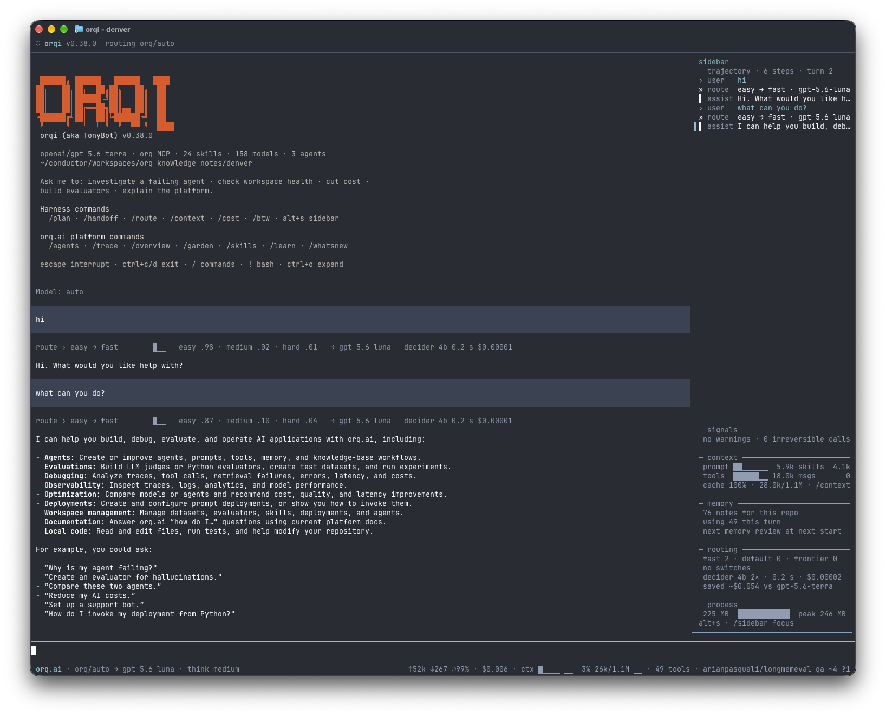

> **Alpha.** Under active development. Expect rough edges.

**orqi** (aka TonyBot) is the orq.ai helper agent in your terminal.

Ask about your workspace in plain words. It answers with your workspace's own tools, models and
skills, already connected.


<p align="center"><sub><strong>A session on <code>orq/auto</code>.</strong> Each message is routed to a model, and the sidebar shows the trajectory, the context, memory and what routing saved.</sub></p>

## Start in a minute

1. **Install**

   ```bash
   curl -fsSL https://raw.githubusercontent.com/orq-ai/orqi/main/install.sh | sh
   ```

   Or `npm install -g @orq-ai/orqi`, which is the one to use on Windows.

2. **Run** `orqi`
3. **Sign in** when it asks: in the browser, or paste an API key.
4. **Type** `/learn` for six guided first prompts.

Keep the [orq CLI](https://github.com/orq-ai/orq-cli) on your `PATH`. orqi uses it to sign in and to
find your workspace. More install options: [docs/install.md](docs/install.md).

## Ask it things like

- "Why is my agent failing?"
- "Which model costs the most this week?"
- "Build an evaluator for hallucinations."
- "Compare these two agents."
- "How do I invoke my deployment from Python?"

## Three ways to run it

| Command | What happens |
|---|---|
| `orqi` | Opens the app |
| `orqi "why did my agent fail today?"` | Answers once, then exits |
| `orqi --session <id>` | Reopens a past session. The id is printed when one ends |

## Why orqi

- **Already connected.** The workspace's models, orq.ai tools and skills load at start.
- **You see what it does.** The sidebar shows every step, warnings, context use, routing and memory.
- **Cheaper answers.** `orq/auto` sends easy messages to a fast model and hard ones to a strong one.
- **Safe by default.** Deletes and other calls that cannot be undone ask first. So do shell commands.
- **Plan first.** `/plan` makes the session read-only until you approve a plan.
- **Talk to your agents.** `/agents` lists the workspace's agents, and `/agent <key>` talks to one.

## Commands to know

**Harness**

| Command | Does |
|---|---|
| `/plan` | Read-only mode. Look, ask, plan. Nothing changes until you approve |
| `/handoff <goal>` | Starts a fresh session with a drafted summary of this one |
| `/route` | How `orq/auto` picks a model, and its settings |
| `/context` | What fills the context window |
| `/cost` | What this session cost, per model |
| `/btw <question>` | A side question on the cheapest model, kept out of the chat |
| `alt+s` | Shows or hides the sidebar |

**orq.ai platform**

| Command | Does |
|---|---|
| `/agents` | The workspace's agents: talk, inspect, traces |
| `/trace` | The last answer's trace: route, spans, cost |
| `/overview` | Agents, prompts, datasets, experiments, evaluators |
| `/garden` | The model garden in your browser |
| `/skills` | The loaded skills |
| `/learn` | Guided prompts, one per platform area |
| `/whatsnew` | The latest orq.ai release |

**Keys:** `esc` interrupts · `ctrl+c` exits · `/` lists every command · `!` runs a shell command ·
`ctrl+o` expands a tool result

Every command and key: [docs/commands.md](docs/commands.md).

## Updating

Run `orqi update`. orqi tells you when a release is out. It never updates itself.

## When something is off

- **Not signed in?** `/login` or `/key`.
- **Wrong workspace?** `/workspace` picks another.
- **Something broken?** `/doctor` checks your setup.
- **Found a bug?** `/bug` opens a prefilled issue.

Which credential wins and what each sign-in error means: [docs/credentials.md](docs/credentials.md).

## Learn more

| Doc | For |
|---|---|
| [docs/commands.md](docs/commands.md) | Every command, key and safety prompt |
| [docs/configuration.md](docs/configuration.md) | Environment variables, themes, where settings live |
| [docs/install.md](docs/install.md) | Installers, platforms, checksums, building from source |
| [docs/credentials.md](docs/credentials.md) | Credentials, hosts, profiles, sign-in errors |
| [ARCHITECTURE.md](ARCHITECTURE.md) | How it is built |
| [AGENTS.md](AGENTS.md) | Rules for changing the code, and releasing |
| [SECURITY.md](SECURITY.md) | What orqi downloads and runs |

---

MIT licensed. Built by [orq.ai research labs](https://orq.ai).
