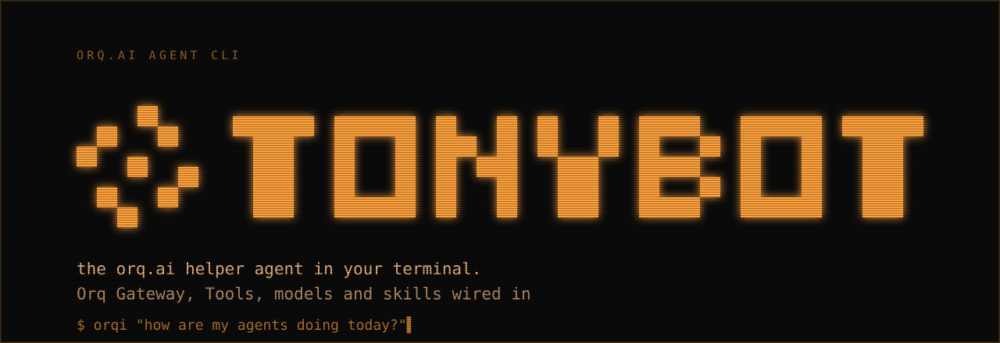
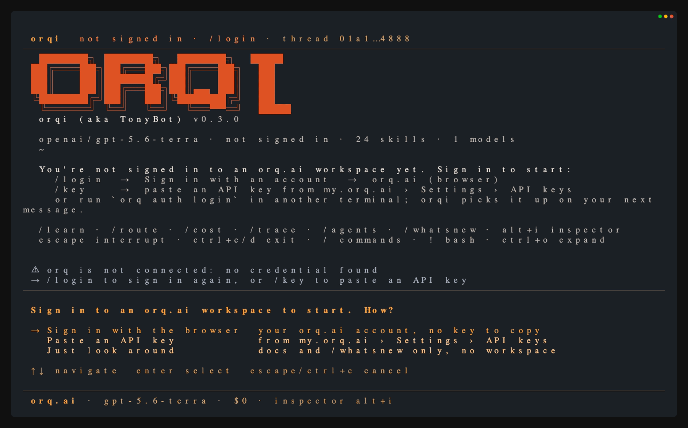
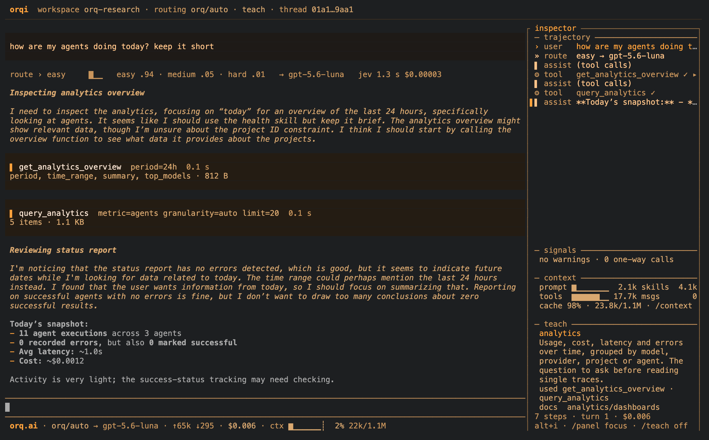

> **Alpha.** Under active development. Expect rough edges and breaking changes.

**orqi** (aka TonyBot) is the orq.ai helper agent in your terminal. Ask it to investigate a failing
agent, check workspace health, cut cost, build evaluators, or explain the platform, and it answers
with your workspace's own tools, models and skills already wired in. No setup, no glue code.

It embeds the [pi coding agent](https://github.com/earendil-works/pi) in-process and boots with the
orq MCP tools, the orq skills and the orqi system prompt already wired in.


<p align="center"><sub><strong>First run.</strong> Sign in with the browser, paste an API key, or explore without a workspace.</sub></p>


<p align="center"><sub><strong>After sign-in.</strong> A live workspace answer with tool calls and the inspector's trajectory, signals, and context.</sub></p>

```
orqi                                   # interactive TUI
orqi "why did my agent fail today?"    # one-shot, prints and exits
```

## Install

```bash
curl -fsSL https://raw.githubusercontent.com/orq-ai/orqi/main/install.sh | sh
```

Pulls the latest release binary, no clone, no Bun. With Node installed, npm works too:

```bash
npm install -g @orq-ai/orqi
```

npm installs only the binary for your platform (macOS arm64, macOS x64, linux x64). `orqi update`
works for both: an npm install is updated through npm.

Both installers check the download against the `.sha256` published with each release and refuse
to install on a mismatch. `gh attestation verify orqi-linux-x64.tar.gz -R orq-ai/orqi` proves which
workflow run built a tarball.

Then run `orqi`. With nothing set up it opens a welcome: sign in with the browser, or paste an API
key from my.orq.ai › Settings › API keys. `/learn` is a good first command after that. You can also
sign in beforehand with the [orq CLI](https://github.com/orq-ai/orq-cli) (`orq auth login`) or export
a valid `ORQ_API_KEY`. Keep the orq CLI on `PATH` either way: orqi asks it for the host and the login
session at startup, the browser sign-in runs it, and `/whoami`, `/workspace` and `/doctor` shell out
to it. Without it, only a pasted or exported key works.

```bash
orqi update             # update to the latest release (through npm for an npm install)
```

When you open orqi it checks for a newer release (at most once an hour) and, if there is one, shows an
"Update available" notice above the editor with the command to run, like pi does; it clears after your
first message. `orqi update` itself never runs automatically.

## What it ships with builtin

| | |
|---|---|
| **orq AI Router** | The only model provider, so `/model` offers exactly the models the workspace has enabled |
| **7 workspace commands** | `/login` → Sign in with an account → `orq.ai` is pi's, wired to the orq browser login; beside it `/key` (paste an API key, masked), `/tools`, `/whoami`, `/workspace [key]`, `/reconnect`, `/doctor`, `/update` |
| **A harness you can see through** | A fixed header with the workspace, project, active agent, routing and thread; a footer with the orq.ai mark, the model that answered, tokens, cost and a context bar with a per-turn sparkline; the inspector beside the transcript (`alt+i`, `/panel focus`, the mouse wheel scrolls it): the trajectory of every step, then warnings such as a tool loop, where the context goes, orqi's memory use, and the tips card; `/context` for the full breakdown and what would change it; a teach card on each platform concept a run touches (on by default, `/tips off` hides it; `/teach` remains an alias); `/cost` per model; `/trace` for a turn's spans and smart-router decision; `/open` for the session's thread in Studio; `/trajectory` to export the session as a Harbor ATIF file; `/whatsnew` renders the latest orq.ai release in the terminal; `/tools` and `/skills` browse what is loaded, filter as you type, and open any one for its definition |
| **Smart routing you can watch** | `orq/auto` (`/model orq/auto` or `ORQI_MODEL=orq/auto`) asks the orq Decisions API how hard each turn is and routes it to an easy, medium or hard model from your workspace, with a route line above the turn showing the probabilities, the pick, and what the decision cost. The same call asks whether the request can be undone: anything that changes state goes to the hard model. `/route explain` prints the question and the pool, `/route platform` lists the workspace's smart routers |
| **Workshop onboarding** | A first run with nothing set up opens a welcome instead of exiting: paste an API key, sign in with the browser, or look around. `/learn` offers six guided prompts, one per platform area; `/btw <question>` answers a side question on the cheapest model without adding it to the conversation |
| **Asks before what cannot be undone** | An orq call that deletes, submits or invokes (`delete_*`, `submit_*`, `invoke_*`, and any verb orqi does not know) waits for Allow once, Allow for this turn, or Deny; a one-shot run refuses it. Creates and updates run without asking and are counted. On quit, orqi prints what the session did: time, cost per model, tools, what changed, and the thread link |
| **Managed agents** | `/agents` refreshes then lists the workspace's agents, filtered as you type (enter opens one; there, enter talks, `i` inspects, `t` traces, `o` opens Studio); `/agent <key>` talks to one, with orqi's own prompt and tools switched off and a line above the editor saying so; `/agent off` returns to orqi. `/refresh` reloads both Model Garden and managed agents so new models appear in pi's `/model` picker without signing out or restarting. The `subagent` tool delegates to `agent/<key>` too |
| **44 orq MCP tools** | Every tool the workspace's MCP server exposes today, minus three invocation surfaces ([why](ARCHITECTURE.md#tools)). Served through pi's own MCP support as `mcp__orq__*`, the names any pi user gets; `/mcp` inspects and reconnects. Results render as a one-line summary (`23 items · 6.0 KB`); `ctrl+o` expands to pretty-printed JSON. The model always receives the full payload |
| **The orq plugin, kept current** | The marketplace's `orq` plugin ([orq-ai/assistant-plugins](https://github.com/orq-ai/assistant-plugins)): 17 skills and its slash commands (`/quickstart`, `/traces`, `/analytics`, `/orq-manage-skills`; its `/models` is left out, `/model` lists the same), plus the 7 orqi skills. orqi checks once a day and switches to a newer plugin without waiting for a release, never to an older one |
| **3 subagents** | `investigator`, `analyst`, `docs`, in-process, each with a narrow orq tool subset |


Model calls route through the orq AI Router, registered as a single pi provider named `orq` whose
model list is the workspace's own enabled catalogue, so `/model` offers exactly what the workspace
allows and one orq credential covers both the LLM and the tools.

## Environment

| Variable | Purpose |
|---|---|
| `ORQ_API_KEY` | Credential; falls back to the `orq auth login` session when unset or rejected. Works on its own, no session file needed. A pinned profile outranks it |
| `ORQ_SERVER` | API base URL (default `https://my.orq.ai`, as in CLI 11), and so which login session the CLI resolves, since a browser login belongs to a server. The only variable that picks the host; `ORQ_MCP_URL` and `ORQ_GATEWAY_URL` override single endpoints |
| `ORQ_PROFILE` | Which API-key profile the orq CLI authenticates with; orqi uses that profile's key and follows whichever host the CLI resolves from it |
| `ORQI_MODEL` | Router model (default `openai/gpt-5.6-terra`) |
| `ORQI_TUI` | `regular` renders inline instead of fullscreen; the inspector then floats as an overlay instead of taking its own columns |
| `ORQI_ROUTE_POOL` | Override `orq/auto` rungs: `easy=openai/gpt-5.6-luna,hard=anthropic/claude-opus-5` |
| `ORQI_ROUTE_LOG` | `1` appends each routing decision to `~/.orqi/agent/routes.jsonl` (prompt hash, tier, probabilities, model, cost, latency, door) |
| `ORQI_ROUTE_THRESHOLDS`, `ORQI_ROUTE_CLASSIFIER` | Expected-tier cut points (default `0.5,1.5`) and the classifier model (default `typesafe/jev-latest`) |
| `ORQI_TAG` | Sent as `X-ORQ-METADATA-tag` on every router call, so a workshop instructor can filter the Threads tab by it |
| `ORQI_WORKSPACE` | Workspace key for Studio links (`/open`, `/trace`), for an API key that cannot read its own workspace's settings |
| `ORQI_THEME` | `dark` selects the theme that keeps turquoise for success and red for errors; the default is one-hue amber. `/theme` switches mid-session |
| `ORQI_TERMINAL_PROGRESS` | Set to `0` to turn off the moving progress line your terminal draws while orqi works (Ghostty, WezTerm, Windows Terminal, iTerm2 3.6+; off by default on older iTerm2, which would show it as notifications) |
| `ORQI_LOCAL_SKILLS` | Also discover skills installed on the machine (off by default; 100+ ambient skills would swamp the prompt) |
| `ORQI_ALL_TOOLS` | Set to `1` to also expose the invocation tools that are filtered out by default ([why](ARCHITECTURE.md#tools)) |
| `ORQI_SKILLS_UPDATE` | Set to `0` to pin skills to whatever the binary shipped with, disabling the daily check |
| `ORQI_UPDATE_CHECK` | Set to `0` to pin: no update check, no launch notice. `orqi update` still works when run directly |
| `ORQI_REFRESH_MODELS`, `ORQI_REFRESH_SKILLS`, `ORQI_REFRESH_UPDATE` | Refresh the model catalogue at startup, force a skills check, or force an update check now, ignoring their cache. In a running session, use `/refresh` instead. |
| `ORQI_AGENT_DIR`, `ORQ_MCP_URL`, `ORQ_GATEWAY_URL` | Override the agent dir / endpoints (on-prem) |
| `ORQI_VERSION` | Pins the release tag: which one `install.sh` installs, and which one `orqi update` installs |
| `ORQI_INSTALL_DIR` | Read by `install.sh` only: where the binary lands (default `~/.local/bin`) |
| `CI` | A non-empty value suppresses the daily update check unless `ORQI_REFRESH_UPDATE=1` forces one |

### Launching from the orq CLI

`orq orqi` installs orqi if needed and launches it with the CLI's resolved server (`ORQ_SERVER`) and,
for a pinned profile, its key (`ORQ_API_KEY`). orqi reads both, so a profile, an on-prem host or a
workspace switch made in the CLI carries over with nothing to configure.

### Picking a credential

Five candidates, best first: the credential `/login` or `/key` stored, a pinned profile's key, then
`ORQ_API_KEY`, then the key `orq auth login --api-key` stored, then the `orq auth login` session.
Each is checked with one API call, so a rejected one falls through to the next. The profile wins
over an exported key because it does for the orq CLI too. If every one is rejected, orqi still
opens, pins a warning naming every source tried and what the server said, and reconnects on your next message
once `/login` (browser or key), `/key` or `orq auth login` has produced a credential it accepts.

```bash
# 1. Nothing set: the login session, on whatever host the CLI resolved.
orq auth login
orqi

# 2. A key on its own. No CLI login needed, but keep the CLI on PATH.
export ORQ_API_KEY=sk-orq-EXAMPLEKEY000000000000000
orqi

# 3. Another host. ORQ_SERVER picks the API base URL and the login session that belongs to it.
export ORQ_SERVER=https://acme.example.orq.ai
orq auth login
orqi

# 4. A profile, pinned for one command. Its own server comes with it, so this
#    talks to whatever host `acme-staging` was created against.
orq auth profile add acme-staging sk-orq-EXAMPLEKEY111111111111111   # once
ORQ_PROFILE=acme-staging orqi "which agents are failing?"

# 5. The same profile through the CLI wrapper, which installs orqi if it is missing
#    and hands the key and the server down itself.
orq --profile acme-staging orqi
```

In 4 and 5 the profile beats anything in `ORQ_API_KEY`, and orqi says which credential won on its
startup line. The full resolution (candidate order, host precedence, every failure message) is in
[docs/credentials.md](docs/credentials.md).

The CLI keeps its own agent dir (`~/.orqi/agent`) and never touches `~/.pi`.

## Build from source

```bash
bun install
bun run start           # or: bun link && orqi
bun test
```

Requires [Bun](https://bun.sh) and the [orq CLI](https://github.com/orq-ai/orq-cli) on `PATH`.

## Docs

- [ARCHITECTURE.md](ARCHITECTURE.md): how the pieces fit, how tools and models are wired, known
  rough edges.
- [docs/credentials.md](docs/credentials.md): which credential wins, which server it goes to, and
  what every failure message means.
- [AGENTS.md](AGENTS.md): working notes for changing the code, plus the release process.
- [SECURITY.md](SECURITY.md): what orqi downloads and executes, including the daily unsigned
  skills update and how to pin it.

---

MIT licensed. Built by [orq.ai research labs](https://orq.ai).
